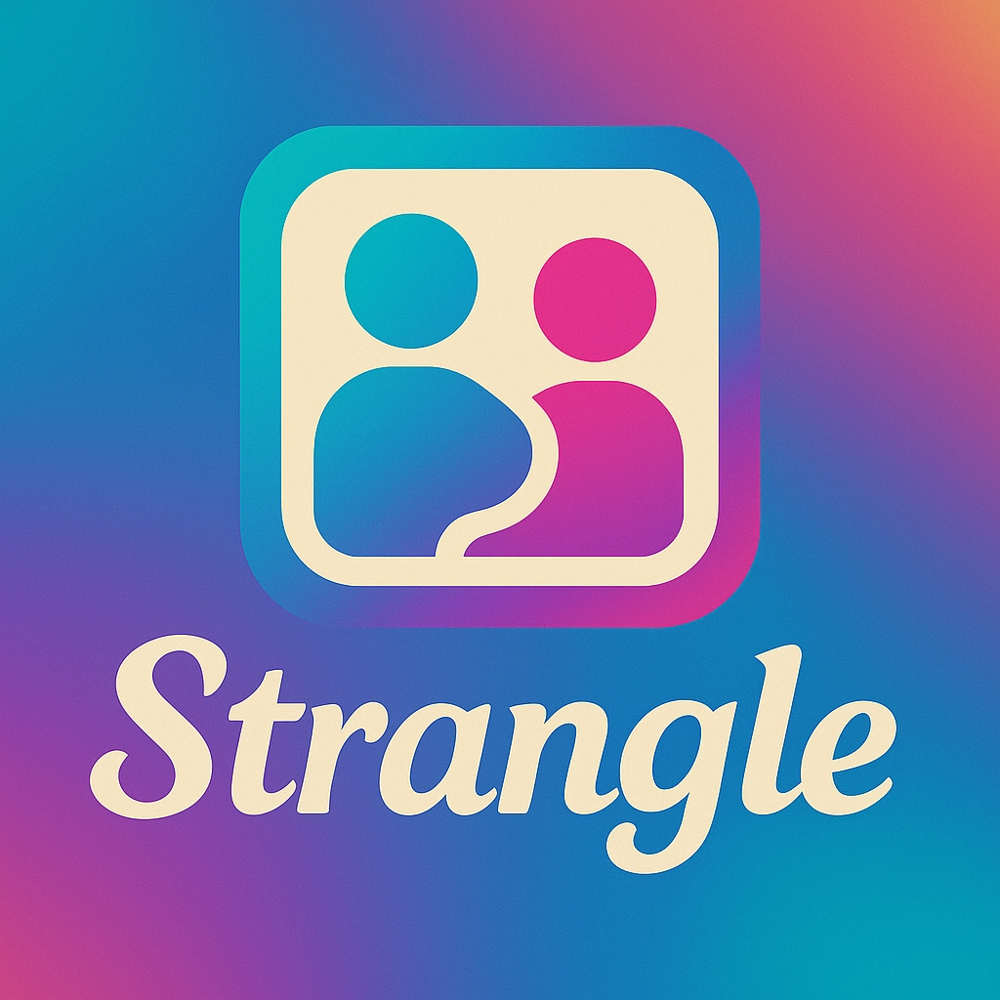
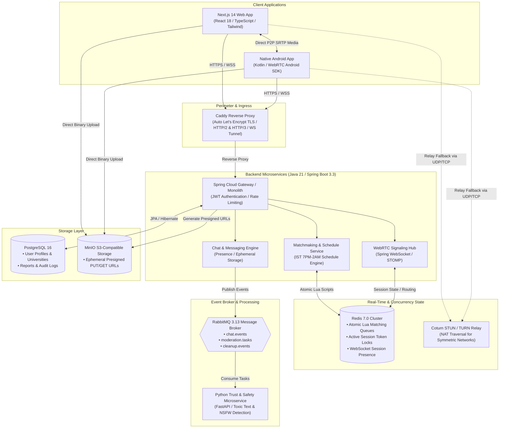
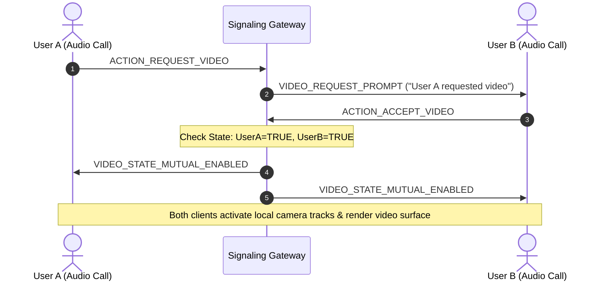
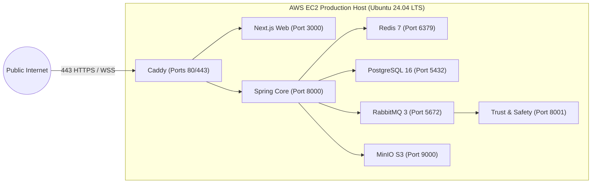

<p align="center">
  
</p>

<h1 align="center">Strangle — Architecture Showcase & Technical Case Study</h1>

<p align="center">
  <b>A High-Concurrency, Ephemeral, Voice-First Social Discovery Platform</b><br />
  Engineered with Java 21, Spring Boot, WebRTC, Redis, RabbitMQ, Docker, and AWS EC2.
</p>

<p align="center">
  <a href="https://strangle.in/"></a>
  
  
  
  
  
  
  
</p>

---

> [!NOTE]
> **Proprietary Notice**: The core production codebase for Strangle is maintained in a private repository for intellectual property, security, and proprietary business logic protection. This repository serves as the **official public architectural showcase, system design case study, and technical documentation** for engineering evaluators, recruiters, and technical peers.
> 
> 🌐 **Live Web Application**: [https://strangle.in](https://strangle.in)

---

## 📑 Table of Contents
- [1. Executive Summary](#1-executive-summary)
- [2. System Architecture](#2-system-architecture)
- [3. Core Technical Engineering Deep Dives](#3-core-technical-engineering-deep-dives)
  - [3.1 High-Concurrency Matchmaking Engine (Redis Lua Scripts)](#31-high-concurrency-matchmaking-engine-redis-lua-scripts)
  - [3.2 Cross-Platform WebRTC Signaling & NAT Traversal](#32-cross-platform-webrtc-signaling--nat-traversal)
  - [3.3 Mutual Video Consent Handshake (Privacy by Default)](#33-mutual-video-consent-handshake-privacy-by-default)
  - [3.4 Continuous Successive Discovery Flow (Seamless NEXT Session Engine)](#34-continuous-successive-discovery-flow-seamless-next-session-engine)
  - [3.5 Event-Driven Architecture & Ephemeral Storage (RabbitMQ & MinIO)](#35-event-driven-architecture--ephemeral-storage-rabbitmq--minio)
  - [3.6 Polyglot Microservices: Python Trust & Safety](#36-polyglot-microservices-python-trust--safety)
- [4. Production Infrastructure & DevOps](#4-production-infrastructure--devops)
- [5. Technology Stack Summary](#5-technology-stack-summary)
- [6. Author & Contact](#6-author--contact)

---

## 1. Executive Summary

**Strangle** is a production real-time voice and video discovery platform built to connect users authentically while putting privacy and safety first.

### Key Pillars:
1. **Voice-First by Default**: Every random match initiates as encrypted, voice-only audio. Cameras are physically deactivated until both participants complete a mutual, two-way consent handshake.
2. **Continuous Successive Discovery (`MATCH -> TALK -> NEXT`)**: Users can transition immediately between partners without returning to the home screen or reloading the DOM.
3. **Verified Campus Community Pools**: Multi-tenant queue isolation allows verified university students to match exclusively within their university domain via institutional email verification (`.edu`, `.ac.in`).
4. **Zero-Leak Ephemerality**: Chat messages and temporary media expire automatically through asynchronous queue shredders and background cron eviction workers.

---

## 2. System Architecture

Strangle is built on a decoupled, polyglot microservices topology deployed inside Docker containers on AWS EC2, fronted by a high-performance Caddy reverse proxy:



---

## 3. Core Technical Engineering Deep Dives

### 3.1 High-Concurrency Matchmaking Engine (Redis Lua Scripts)
- **The Concurrency Problem**: In a random discovery system, multiple users search concurrently. Polling a relational database with `SELECT ... FOR UPDATE` causes severe row-locking contention, connection pool starvation, and race conditions where two threads can pair the same user with two different partners simultaneously.
- **The Solution**: Strangle uses **Redis Sorted Sets (`ZSET`)** with epoch millisecond timestamps as scores to enforce FIFO ordering. All queue pairing operations are executed via an **atomic Lua script**:
  - The script executes atomically within Redis's single-threaded event loop.
  - No other Redis operation can interleave during the execution.
  - If a partner is found in the opposite queue, both users are popped and atomically bound to an active session lock (`SETEX session:user:{id} 60 partnerId`).
  - If no partner is found, the user is added to the waiting queue with an automatic TTL.

```lua
-- Atomic Matchmaking Pairer (Evaluated in-memory on Redis)
local candidate = redis.call('ZPOPMIN', KEYS[2], 1)
if candidate and #candidate > 0 then
    local partnerId = candidate[1]
    -- Atomically assign mutual session lock
    redis.call('SETEX', 'session:user:' .. ARGV[1], 60, partnerId)
    redis.call('SETEX', 'session:user:' .. partnerId, 60, ARGV[1])
    return partnerId
else
    -- Add searching user to pool
    redis.call('ZADD', KEYS[1], ARGV[2], ARGV[1])
    return nil
end
```

### 3.2 Cross-Platform WebRTC Signaling & NAT Traversal
Connecting modern web browsers (**Next.js / WebRTC Web API**) with native mobile devices (**Android / WebRTC C++ JNI SDK**) requires rigid protocol adherence:
1. **Signaling Hub**: Built on **Spring WebSocket with STOMP subprotocol**. Clients subscribe to user-specific private topics (`/queue/call.{userId}`).
2. **SDP Negotiation**: Peer A sends an SDP Offer over STOMP; Peer B sets `remoteDescription`, generates an SDP Answer, and returns it over the signaling channel.
3. **Trickle ICE & NAT Traversal**:
   - Clients query STUN servers to resolve their public IP:Port candidates.
   - For users behind **Symmetric NATs** (mobile cellular networks, campus firewalls), direct peer-to-peer UDP packet transmission fails. Strangle deploys a dedicated **Coturn TURN relay** server that acts as an authenticated media proxy.

### 3.3 Mutual Video Consent Handshake (Privacy by Default)
To protect user comfort and safety, video streams are physically inhibited until explicit two-way agreement is validated:



### 3.4 Continuous Successive Discovery Flow (Seamless NEXT Session Engine)
In standard calling apps, ending a call forces a redirection back to a dashboard. In Strangle, clicking **NEXT** achieves instant discovery continuity:
1. **In-Flight Click Guard**: Disables the NEXT button immediately (`isNextInFlightRef`) to prevent duplicate requests.
2. **Session Cleanup**: Emits a `MATCH_LEAVE` event, closes the active `RTCPeerConnection`, stops local hardware audio/video tracks, and clears the Redis session lock.
3. **Immediate Discovery Re-Queue**: Without leaving the call view, the client calls `/api/v1/matching/start`. A smooth radar animation indicates active searching until the next partner is found and connected.

### 3.5 Event-Driven Architecture & Ephemeral Storage (RabbitMQ & MinIO)
- **Decoupling via RabbitMQ**: Chat deliveries, audit trails, and moderation events are pushed to RabbitMQ exchanges rather than processed synchronously in the HTTP request thread, reducing API response times to $< 20\text{ms}$.
- **Presigned URLs with MinIO**: Instead of streaming multi-megabyte image binaries through the Spring Boot JVM, Spring issues time-limited (5-minute expiration) **Presigned PUT URLs**. Clients upload binary payloads directly to S3-compatible MinIO storage.
- **Automated Ephemeral Shredding**: A scheduled Spring worker (`@Scheduled(cron = "0 0 * * * *")`) scans and hard-deletes expired message records and orphaned media files to ensure zero persistent privacy footprint.

### 3.6 Polyglot Microservices: Python Trust & Safety
A dedicated Python (FastAPI) microservice runs alongside the Java backend:
- Consumes user-reported content and chat transcripts via RabbitMQ.
- Applies automated toxicity classification and NSFW image detection filters.
- Enforces progressive penalty strikes and automated cooldown locks on offending accounts.

---

## 4. Production Infrastructure & DevOps

Strangle runs on an **AWS EC2 instance** in the `ap-south-1` (Mumbai) region:



### CI/CD & Zero-Downtime Deployment
- **GitHub Actions Pipeline (`ci.yml` & `deploy.yml`)**:
  - Automatically compiles and executes unit tests on JDK 21, Python 3.12, Node 20, and Android Gradle.
  - Validates Docker Compose integrity on every commit.
  - Automated deployment engine (`scripts/deploy.sh`) computes `git diff` against the previous good commit and performs **selective zero-downtime container rebuilds** (e.g., rebuilding only the Web container if backend code was not modified).
  - Pre-flight checks verify disk safety buffers ($\ge 2\text{ GB}$ free space), and post-flight smoke tests verify live HTTP 200 responses before concluding.

---

## 5. Technology Stack Summary

| Layer | Technologies Used | Key Purpose |
| :--- | :--- | :--- |
| **Backend Core** | Java 21, Spring Boot 3.3, Spring Security, Spring Data JPA | Core REST API, JWT auth, business logic, transaction management |
| **Real-Time & Signaling** | WebSockets (STOMP), SockJS, WebRTC, Coturn | Low-latency signaling, SDP offer/answer, trickle ICE, TURN relay |
| **In-Memory & State** | Redis 7.0 (Lua Scripting, Sorted Sets, Hashes) | Atomic matchmaking queues, session locks, presence tracking |
| **Messaging & Queues** | RabbitMQ 3.13, AMQP | Asynchronous event dispatch, chat queuing, moderation tasks |
| **Trust & Safety Service** | Python 3.12, FastAPI, Uvicorn, PyTorch / OpenCV | Asynchronous NSFW detection, toxic language screening |
| **Databases & Storage** | PostgreSQL 16, MinIO (S3-Compatible Object Storage) | Relational persistence, encrypted presigned URL media uploads |
| **Web Frontend** | Next.js 14, React 18, TypeScript, Tailwind CSS | Responsive responsive UI, WebRTC media streaming, client state |
| **Mobile Client** | Android (Kotlin), Jetpack Compose, WebRTC Android SDK | Native audio/video capture, hardware codec acceleration |
| **Ingress & Security** | Caddy 2, Let's Encrypt SSL/TLS, HTTP/2 & HTTP/3 | Reverse proxy, automatic certificate renewal, WebSocket tunneling |
| **Cloud & DevOps** | AWS EC2 (ap-south-1), Docker, Docker Compose, GitHub Actions | Containerized microservices, automated CI/CD, selective deployment |

---

## 6. Author & Contact

**Jay Singh**  
*Founder & Lead Backend Engineer*  
- 🌐 **Live Website**: [strangle.in](https://strangle.in)  
- 💼 **LinkedIn**: [linkedin.com/in/jay-singh-raghuvanshi](https://www.linkedin.com/in/jay-singh-raghuvanshi)  
- 🐙 **GitHub**: [github.com/jerryRaghuvanshi](https://github.com/jerryRaghuvanshi)  
- 📧 **Email**: [jay10125r@gmail.com](mailto:jay10125r@gmail.com)  
- 📁 **Portfolio**: [my-portfolio-eight-phi-88.vercel.app](https://my-portfolio-eight-phi-88.vercel.app/)
